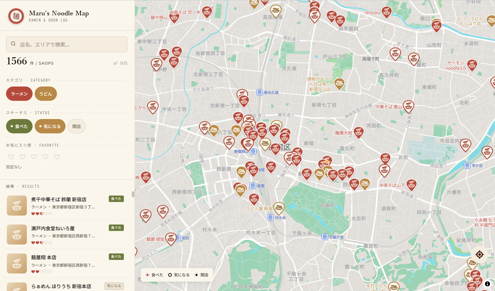
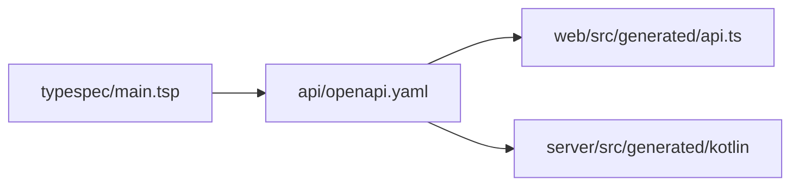

# NoodleMap

NoodleMap is my personal map for ramen, udon, and other noodle shops I have eaten at or want to keep track of. The repository is public, but it is primarily maintained as a personal project and operations notebook rather than a contributor-facing open source project.

Live app: https://noodle-map.marulabs.dev/



## Stack

- Frontend: React, TypeScript, React Router, Vite, Chakra UI, MapLibre GL, Google Maps APIs
- Backend: Kotlin, Ktor, SQLDelight, SQLite
- API contract: TypeSpec -> OpenAPI -> generated frontend/backend API types
- Local orchestration: Docker Compose
- Deployment: Render Blueprint in `render.yaml`
- Infrastructure: Terraform for Cloudflare/R2-related resources
- Tooling: `mise` is introduced and will be expanded as the main tool version manager

## Repository Layout

- `web/`: frontend app
- `server/`: Kotlin/Ktor API server
- `e2e/`: Playwright end-to-end tests
- `db/`: seed data and the local seed script
- `typespec/`: TypeSpec API contract source
- `api/openapi.yaml`: generated OpenAPI output
- `terraform/`: Terraform configuration
- `docs/`: supporting notes and documentation

Generated files are committed for reviewability:

- `api/openapi.yaml`
- `web/src/generated/api.ts`
- `server/src/generated/kotlin/**`

Do not edit generated files directly. Update `typespec/main.tsp` first, then regenerate.

## Common Commands

Frontend:

```sh
cd web
npm run dev
npm run build
npm run lint
npm run format
```

Backend:

```sh
cd server
./gradlew run
./gradlew test
```

API generation from the repository root:

```sh
npm run api:generate
npm run api:check
```

Docker Compose from the repository root:

```sh
docker compose up --build
```

The Compose setup starts the API server on `http://localhost:8888` and the frontend on `http://localhost:8080`.

### Local database

`./gradlew run`, `mise run dev`, and Docker Compose copy the committed `db/default.db`
to `db-data/noodle_map.db` when the destination does not exist. Existing databases,
including empty files, are never replaced. The server applies pending migrations
after opening the copy. Set `DB_PATH` to choose another destination.

The CSVs in `db/data/` remain the seed data source. After changing them or the
schema migrations, rebuild the template from the repository root with JDK 21 and
Python 3 available:

```sh
python3 db/generate_default.py
```

Commit the updated CSVs and `db/default.db` together. Generation uses the server's
migration runner, checks SQLite integrity and foreign keys, and publishes a
standalone database without users, sessions, or WAL sidecars. Seed timestamps
use `2000-01-01` because the CSVs do not contain creation or closure dates.
Regeneration updates only the template. It does not change an existing local database.

`DB_SEED_PATH` enables the same first-start copy for other server launch methods.
Gradle `run` supplies the template path by default; set `DB_SEED_PATH` to an empty
string to start a new empty local database instead. Packaged servers and E2E tests
do not seed unless explicitly configured.

### Required environment variables for local development

The backend now authenticates exclusively via Google Sign-In, so the following variables must be set in `.env` / `web/.env` before `./gradlew run` or `docker compose up` will work:

- `GOOGLE_OAUTH_CLIENT_ID` (server) — OAuth 2.0 Client ID from Google Cloud Console.
- `VITE_GOOGLE_OAUTH_CLIENT_ID` (frontend) — same value as above; the Sign-In button does not render without it.
- `ADMIN_EMAIL` (server) — Google account email that should receive admin rights. Without it, **no user can access `/admin`**. The first Google login from this address provisions the admin account.

Optional:

- `GOOGLE_PLACES_API_KEY` (server) — Places API (New) key for the admin add form's Google Place search. Without it, the search shows a fallback and shop details are entered by hand.

## API Contract Flow



When changing routes, request/response shapes, or API-facing models:

1. Update `typespec/main.tsp`.
2. Run `npm run api:generate`.
3. Use generated frontend types from `web/src/generated/api.ts`.
4. Keep backend route wiring through the generated `server` controller interfaces.

## mise

`mise` is already present via `.mise.toml`.

Current responsibilities:

- Pin Node.js to the latest `24.x` (run `mise up node` for new patches) and Terraform to `1.15.5`.
- Load local environment values from `.env`.
- Set AWS checksum options required by the current R2/S3-compatible tooling.

The JDK and other developer tools may be moved into `mise` later as the local workflow becomes more standardized.

## Terraform

Terraform lives in `terraform/` and currently manages Cloudflare/R2-related infrastructure, including the basemap R2 module. State is configured with an S3-compatible backend pointing at Cloudflare R2.

Typical commands:

```sh
cd terraform
terraform init
terraform plan
```

Applying changes requires valid Cloudflare/R2 credentials in the environment. `.env.example` lists the currently expected secret variables.

## Deployment Notes

Render service configuration is defined in `render.yaml`.

- Backend: Docker web service with a persistent disk for SQLite data.
- Frontend: Render static site.
- Public domains: `noodle-map.marulab.jp` and `noodle-map.marulabs.dev`.
- API traffic from the frontend is rewritten to the Render backend.

Secrets such as `GOOGLE_OAUTH_CLIENT_ID`, `ADMIN_EMAIL`, `AWS_ACCESS_KEY_ID`, `AWS_SECRET_ACCESS_KEY`, `GOOGLE_PLACES_API_KEY`, and `VITE_GOOGLE_OAUTH_CLIENT_ID` are configured outside the repository.

## Editing Notes

- Japanese UI text is UTF-8. If text looks garbled, reopen the file as UTF-8 before editing.
- Before finishing frontend text changes, run `npm run check:mojibake` from `web/`.
- After editing any `CLAUDE.md`, run `npm run sync-agents` from the repository root to update the matching `AGENTS.md` files.
